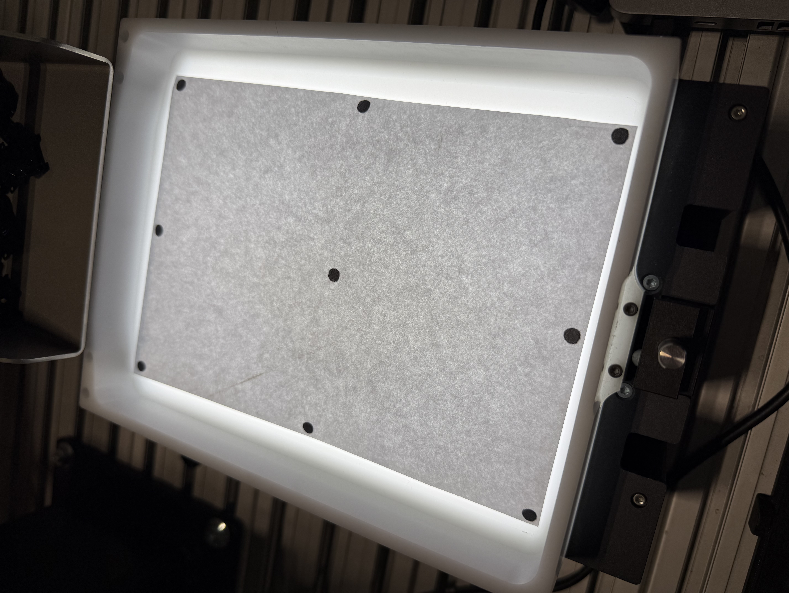
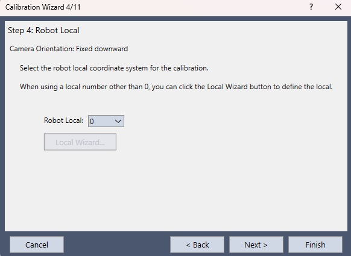
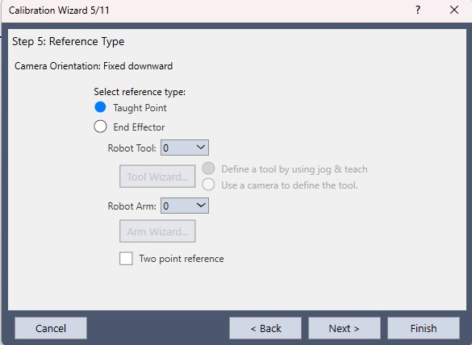
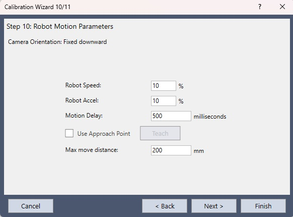
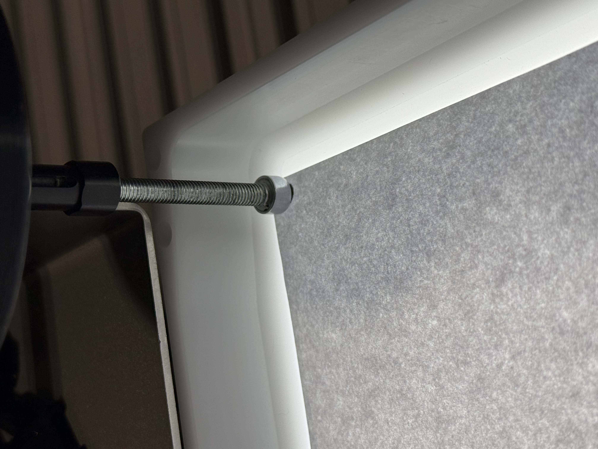

# Kalibracja kamery w systemie wizyjnym EPSON Vision Guide

W tym poradniku skalibrujemy kamerę, która wisi nad robotem EPSON SCARA i patrzy w dół na podświetlaną płytkę z dziewięcioma punktami. Robot dojeżdża końcówką do każdego z nich, a Vision Guide na tej podstawie wylicza skalę obrazu, pole widzenia, pochylenie kamery i błąd kalibracji.

Osoby, które wolą najpierw przejść tę samą ścieżkę bez fizycznego stanowiska, znajdą opis symulacji w artykule [Symulacja systemu wizyjnego w środowisku EPSON RC+ 8](https://www.astor.com.pl/poradnikautomatyka/symulacja-systemu-wizyjnego-w-srodowisku-epson-rc-8/). Tutaj pracujemy na prawdziwym robocie, a kontroler jest podłączony do komputera kablem USB.

## Po co ta kalibracja

Kamera podaje położenie w pikselach, a robot porusza się w milimetrach, dlatego bez przeliczenia jednej jednostki na drugą obrazu nie da się przełożyć na ruch. Sam fakt, że punkt leży w pikselu (400, 300), nie mówi jeszcze, o ile milimetrów przesunąć oś X ani oś Y. Kalibracja wykonuje właśnie to przeliczenie, a gdy punkty odniesienia uczymy robotem, wiąże obraz także z układem współrzędnych stanowiska.

Po zapisaniu kalibracji obiekt Blob zwraca **CameraX** i **CameraY** już w milimetrach. Program pick and place bierze te współrzędne, a robot jedzie w miejsce, które zobaczyła kamera.

Wynik obowiązuje tylko dla ustawienia, w którym powstał. Gdy ktoś poruszy kamerę, zmieni ostrość albo położy detale wyżej niż płytka, wcześniejsze liczby przestają pasować i kalibrację trzeba zrobić od nowa.

## Co jest na stanowisku

Do opisanej kalibracji używamy:

- oprogramowania EPSON RC+ z modułem Vision Guide, połączonego z kontrolerem przez **USB**,
- robota SCARA **T6-B602S**, widocznego w programie jako robot **1, MNP01**,
- kamery **Camera 1**,
- podajnika **Part Feeder 1** z podświetleniem od spodu,
- płytki, na której znajduje się dziewięć ciemnych punktów ułożonych w siatce 3×3.

Płytka leży w białej ramce, a podświetlenie biegnie dookoła niej. Na szarym arkuszu widać dziewięć czarnych kropek, po trzy w każdym rzędzie. W kadrze kamery płytka zajmuje prawie cały obraz, a kropki dochodzą do brzegów, dzięki czemu błąd da się ocenić także przy krawędzi kadru.

## Sekwencja, która znajduje punkty

Zanim otworzymy kreator, potrzebna jest sekwencja, która znajdzie wszystkie dziewięć kropek. Tworzymy ją w oknie **Vision**.

W oknie **New Vision Sequence** wpisujemy nazwę **BlobSeq** i wybieramy kamerę **1. Camera 1**. Pole kopiowania z istniejącej sekwencji zostawiamy puste, po czym zatwierdzamy okno przyciskiem **OK**.

Zaraz potem program pyta o **Part Feeder Backlight**, ponieważ zdjęcie ma powstać na podświetleniu podajnika. Wskazujemy **Part Feeder 1** i klikamy **OK**. Dzięki temu przy uruchomieniu sekwencji podświetlenie włączy się samo, a kropki będą ciemne na jasnym tle, co ułatwi obiektowi Blob ich znalezienie.

W sekwencji dodajemy jeden obiekt typu **Blob** i zostawiamy mu nazwę **Blob01**. Po prawej stronie widać schemat, na którym sekwencja **BlobSeq** prowadzi do kroku **Step 1**. Niebieska ramka na obrazie to okno wyszukiwania. Rozciągamy je na całą płytkę, tak aby wszystkie dziewięć punktów znalazło się w środku.

We właściwościach ustawiamy **NumberToFind** na **All**. Pole robi się czerwone, ponieważ ta wartość różni się od domyślnej, a nam chodzi o to, żeby program znalazł każdą kropkę. **MinArea** zostawiamy na 25 pikseli, a **MaxArea** na 200000, dzięki czemu odsiewamy drobny pył i przypadkową dużą plamę, na przykład od kabla. **Graphics** ustawiamy na **All**, żeby na obrazie rysowało się wszystko, co obiekt znalazł.

Po uruchomieniu sekwencji na liście wyników pojawia się **Result 1 of 9**. Licznik pokazuje dziewięć trafień, a przy znalezionym punkcie widać między innymi pozycję **CameraX** i **CameraY** w milimetrach. Płytka jest więc znaleziona w całości i można przejść do kalibracji.

## Nowa kalibracja

W drzewie projektu, w gałęzi **Vision**, widać sekwencje **BlobSeq**, **Kalibracja**, **DuzyLens** i **MalyDetal**, a niżej gałąź **Calibrations** z kalibracją **Calibr**. W prawym górnym rogu RC+ połączenie jest ustawione na **USB**.

Nową kalibrację otwieramy przyciskiem na pasku okna **Vision**. Na zrzucie przycisk jest obwiedziony czerwoną ramką.

### Krok 1. Nazwa

Kreator prowadzi przez jedenaście kroków. W kroku **General** nadajemy kalibracji nazwę **Kalibracja** i wybieramy kamerę **1. Camera 1**. Kopiowania z istniejącej kalibracji nie używamy, po czym przechodzimy dalej przyciskiem **Next**.

### Krok 2. Jak kamera stoi

W kroku **Camera Usage & Orientation** ustalamy, w jaki sposób kamera pracuje. **Standalone Camera** oznacza kamerę liczoną samodzielnie, natomiast **Robot Camera** przypina kalibrację do konkretnego robota. Z listy wybieramy robota **1, MNP01**. Sposób montażu obejmuje cztery warianty: **Fixed looking upward**, czyli kamerę nieruchomą patrzącą w górę, **Fixed looking downward**, czyli nieruchomą patrzącą w dół, oraz **Mounted on joint 2** i **Mounted on joint 4**, gdy kamera jest zamocowana na ramieniu.

Na zrzucie zaznaczone są **Robot Camera** oraz **Fixed looking downward**, ponieważ nasza kamera stoi sztywno nad stołem i patrzy w dół. Obok widać podgląd takiego układu: statyw nad robotem SCARA, oś Z skierowana w dół oraz osie X i Y rozrysowane na stole.

### Krok 3. Czym szukamy kropek

W kroku **Target Sequence** wskazujemy sekwencję, która podczas kalibracji znajduje punkty płytki, i wybieramy **BlobSeq**.

### Krok 4. Układ lokalny

W kroku **Robot Local** zostawiamy układ o numerze **0**. Kreator informuje, że przy innym numerze trzeba przejść przez **Local Wizard**, a ponieważ pracujemy w układzie bazowym, tego kreatora nie otwieramy.

### Krok 5. Skąd bierzemy współrzędne

W kroku **Reference Type** wybieramy **Taught Point**, ponieważ współrzędne punktów zbierzemy sami, dojeżdżając do nich robotem. **Robot Tool** i **Robot Arm** zostawiamy na 0, a opcję **Two point reference** pozostawiamy odznaczoną. Opcji **End Effector** nie zaznaczamy, dlatego przyciski **Tool Wizard** i **Arm Wizard** zostają wyszarzone.

Kroki 6 i 7 nie wymagają u nas zmian, więc przechodzimy je przyciskiem **Next**.

### Krok 8. Dystorsja i pochylenie

W kroku **Lens Distortion & Camera Tilt Compensation** zaznaczamy **Enable lens distortion and camera tilt compensation**, a jako **Dist Correction Target Sequence** wskazujemy **BlobSeq**. Program skorzysta wtedy z płytki leżącej w kadrze i skoryguje zniekształcenie obiektywu oraz pochylenie kamery. Przy brzegu obrazu skala bez tej korekcji lubi się rozjeżdżać, dlatego zostawiamy tę opcję włączoną.

### Krok 9. Światło

W kroku **Light Control** pole **Calibration lamp on delay** zostawiamy na 0, a **Calibration lamp output bit** ustawiamy na **None**, ponieważ osobnej lampy kalibracyjnej nie używamy. Światło daje podajnik przypisany wcześniej do sekwencji **BlobSeq**. Wyjście przeznaczone dla kamery patrzącej w górę jest wyszarzone, gdyż ta kalibracja go nie dotyczy.

### Krok 10. Jak robot jeździ przy kalibracji

W kroku **Robot Motion Parameters** ustawiamy **Robot Speed** i **Robot Accel** na 10 procent, żeby dojazdy do punktów odbywały się powoli. **Motion Delay** wynosi 500 milisekund, dzięki czemu obraz zdąży się uspokoić po zatrzymaniu ramienia. Opcję **Use Approach Point** zostawiamy odznaczoną, a **Max move distance** ustawiamy na 200 mm.

### Krok 11. Co się zapisuje

Ostatni ekran zbiera ustawienia, które kreator zapisze. Kamera to **1. Camera 1**, orientacja to **Fixed downward**, typ odniesienia to **Taught Points**, a sekwencja wzorca to **BlobSeq**. **Taught Points** oznacza, że współrzędne pochodzą z pozycji, do których dojedziemy robotem. Po kliknięciu **Finish** kalibracja o nazwie **Kalibracja** pojawia się w projekcie.

## Uczenie punktów

Po zamknięciu kreatora na dole okna **Vision** widać pasek **Calibration: Kalibracja**. Przycisk **Teach Points** jest aktywny, natomiast **Calibrate** pozostaje wyszarzony, ponieważ żaden punkt nie został jeszcze nauczony.

Po kliknięciu **Teach Points** po lewej zostaje podgląd kamery z napisem, do którego punktu mamy dojechać, po prawej lista kroków, a z boku panel **Jog**. W tym panelu widać:

- **Motor: On** i **Power: Low**, czyli włączone silniki przy małej mocy, i tak zostawiamy te ustawienia na czas uczenia,
- robota **1, MNP01, T6-B602S**, narzędzie **Tool 0** i ramię **Arm 0**,
- układ **World**, w którym aktywne są osie **X**, **Y**, **Z** i **U**, a **V** oraz **W** pozostają szare, ponieważ T6 jest robotem SCARA i tych osi nie posiada,
- skok w polu **Jog Distance**: **Continuous**, **Long**, **Medium** albo **Short**.

Do zgrubnego podjazdu wystarczy prędkość **High** i ruch ciągły. Ostatnie milimetry lepiej pokonać skokiem **Short**, ponieważ przy ruchu ciągłym końcówka łatwo przeskakuje kropkę.

Kolejność punktów ustala program i nie wybieramy jej sami. Na liście po prawej widać:

1. **Top Left**,
2. **Top Center**,
3. **Top Right**,
4. **Right Center**,
5. **Center**,
6. **Left Center**,
7. **Bottom Left**,
8. **Bottom Center**,
9. **Bottom Right**.

Ostatnia pozycja jest schowana poniżej widocznego fragmentu listy, dlatego trzeba ją przewinąć.

Dojeżdżamy tam, gdzie wskazuje niebieski napis nad obrazem, i klikamy **Teach**. Końcówką jest szpilka zrobiona ze śruby, a nakrętka ma zejść dokładnie na kropkę. Ramię wchodzi wtedy w kadr, ponieważ program zapisuje pozycję robota w chwili, gdy szpilka stoi na punkcie. Nauczony krok zmienia kolor na zielony.

Pierwszy punkt to lewy górny róg płytki.

Po jego zatwierdzeniu program prosi o **Top Center**, a **Teach Step 1** jest już zielony.

W połowie listy zielone są kroki od **Top Left** do **Right Center**, a następnie przychodzi kolej na środek, czyli **Center**.

Gdy wszystkie kroki zmienią kolor, nad obrazem pojawia się komunikat **All calibration points are now taught.** Klikamy wtedy **Finish** i wracamy do okna sekwencji.

## Wynik

Po nauce punktów przycisk **Calibrate** staje się aktywny, a **Teach Points** wygasa. Po kliknięciu **Calibrate** program uruchamia sekwencję **BlobSeq**, o czym informuje napis **Calibration in cycle** u góry obrazu, i po chwili otwiera okno **Calibration Complete**.

Kolumna **Previous values** jest pusta, ponieważ jest to pierwsza kalibracja tej kamery i nie ma jeszcze wcześniejszego wyniku do porównania. W kolumnie **New values** pojawiają się poniższe liczby, a pole widzenia, oznaczone jako **FOV**, ma wymiary **327,83 mm × 244,68 mm**.

| | X | Y |
|---|---|---|
| mm na piksel | 0,2049 | 0,2039 |
| błąd maksymalny | 0,3824 | 0,7339 |
| błąd średni | 0,0135 | 0,0085 |
| pochylenie | 1,09 | 2,03 |

Skala w obu osiach jest prawie taka sama i wynosi około 0,20 mm na piksel, a pochylenie kamery pozostaje niewielkie. Błąd średni to setne części milimetra, czyli wyraźnie mniej niż jeden piksel. Wartość maksymalna, 0,73 mm w osi Y, dotyczy najsłabszej z dziewięciu kropek. Jeżeli ta dokładność nie wystarcza, punkt można nauczyć ponownie i jeszcze raz kliknąć **Calibrate**. Poprzednie liczby przejdą wtedy do kolumny **Previous values**, dzięki czemu widać, czy wynik się poprawił.

Wynik zatwierdzamy przyciskiem **OK**.

Kalibrację powtarzamy wtedy, gdy kamera się przesunie, gdy zmieni się ostrość lub przysłona albo gdy detale zaczną leżeć wyżej niż płytka, na której uczyliśmy punkty.

---

Autor artykułu:

**Maciej Tkacz**

Inżynier Robotyk, ASTOR
