# Kalibracja kamery w systemie wizyjnym EPSON Vision Guide

> **Notatka przed publikacją (do wykreślenia).** Oryginalne nazwy plików nie dotarły ze zrzutami, więc ułożyłem je w kolejności kroków z programu. Dwa identyczne kadry z samą czerwoną ramką pominąłem; został kadr ze strzałką.
>
> Do ujednolicenia: zrzut kroku 2 ma zaznaczone **Robot Camera** i **Fixed looking downward**, a kroki 3, 8, 9 oraz podsumowanie mają nagłówek **Standalone** (w podsumowaniu także **Taught Points**). W tekście każdy ekran jest opisany tak, jak wygląda. Jeśli cała kalibracja była kamerą robota patrzącą w dół, podmień zrzuty kroków 3, 8, 9 i 11. Jeśli była samodzielna, podmień zrzut kroku 2.

**Z tego artykułu dowiesz się:**

- jak przygotować sekwencję, która znajduje dziewięć punktów płytki kalibracyjnej,
- jak przejść kreator kalibracji kamery w Vision Guide,
- jak nauczyć punkty kalibracyjne robotem i ocenić wynik kalibracji.

W tym poradniku skalibrujemy kamerę współpracującą z robotem EPSON SCARA. Kamera patrzy z góry na podświetlaną płytkę z dziewięcioma punktami, a robot dojeżdża końcówką do każdego z nich. Na końcu Vision Guide poda skalę obrazu w milimetrach na piksel, pole widzenia, pochylenie kamery i błąd kalibracji.

Osobom, które chcą najpierw przećwiczyć system wizyjny bez stanowiska, polecamy artykuł [Symulacja systemu wizyjnego w środowisku EPSON RC+ 8](https://www.astor.com.pl/poradnikautomatyka/symulacja-systemu-wizyjnego-w-srodowisku-epson-rc-8/). Tutaj pracujemy na fizycznym robocie, podłączonym do komputera po USB.

## Po co kalibrować kamerę

Obraz z kamery to siatka pikseli. Informacja, że punkt leży w pikselu (400, 300), nie mówi jeszcze, ile to milimetrów ani gdzie ma podjechać robot. Kalibracja wyznacza skalę obrazu, pochylenie kamery względem płaszczyzny roboczej i — gdy punkty odniesienia nauczamy robotem — związek tego obrazu z układem współrzędnych stanowiska.

Dopiero wtedy sekwencja wizyjna zwraca położenie w milimetrach. Na zrzutach widać to w wynikach obiektu **Blob**: pola **CameraX** i **CameraY** są podane w mm. Ta sama kalibracja jest podstawą aplikacji pick and place, w której robot pobiera detal z miejsca wskazanego przez kamerę.

Kalibracja obowiązuje dla konkretnego ustawienia. Przesunięcie kamery, zmiana ostrości, przysłony albo wysokości płytki oznacza, że trzeba ją powtórzyć.

## Stanowisko

Do kalibracji pokazanej w artykule używamy:

- oprogramowania EPSON RC+ z modułem Vision Guide, połączonego z kontrolerem przez **USB**,
- robota SCARA **T6-B602S**, widocznego w programie jako robot **1, MNP01**,
- kamery **Camera 1**,
- podajnika **Part Feeder 1** z podświetleniem od spodu,
- płytki z dziewięcioma ciemnymi punktami ułożonymi w siatce 3×3.

Płytka leży w polu widzenia kamery i zajmuje prawie cały kadr. Punkty są rozstawione od brzegu do brzegu, więc kalibracja obejmuje cały obraz, łącznie z jego krawędziami.

## Sekwencja, która znajduje punkty

Kalibracja potrzebuje sekwencji, która wskaże wszystkie dziewięć punktów płytki. Tworzymy ją przyciskiem nowej sekwencji w oknie **Vision**.

W oknie **New Vision Sequence** wpisujemy nazwę **BlobSeq** i wybieramy kamerę **1. Camera 1**. Pole **Copy from existing sequence** zostawiamy puste i zatwierdzamy **OK**.

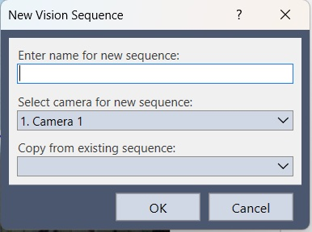

Ponieważ zdjęcie powstaje na podświetleniu podajnika, pojawia się pytanie o **Part Feeder Backlight**. Wybieramy **Part Feeder 1** i klikamy **OK**. Przy uruchomieniu sekwencji program włączy podświetlenie, a punkty będą ciemnymi plamami na jasnym tle.

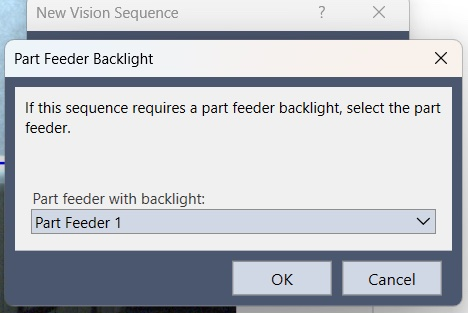

W oknie sekwencji dodajemy jeden obiekt typu **Blob** o nazwie **Blob01**. Po prawej stronie widać schemat: sekwencja **BlobSeq** i krok **Step 1**. Niebieska ramka na obrazie to okno wyszukiwania. Rozciągamy je tak, aby cała płytka znalazła się w środku, razem ze wszystkimi dziewięcioma punktami.

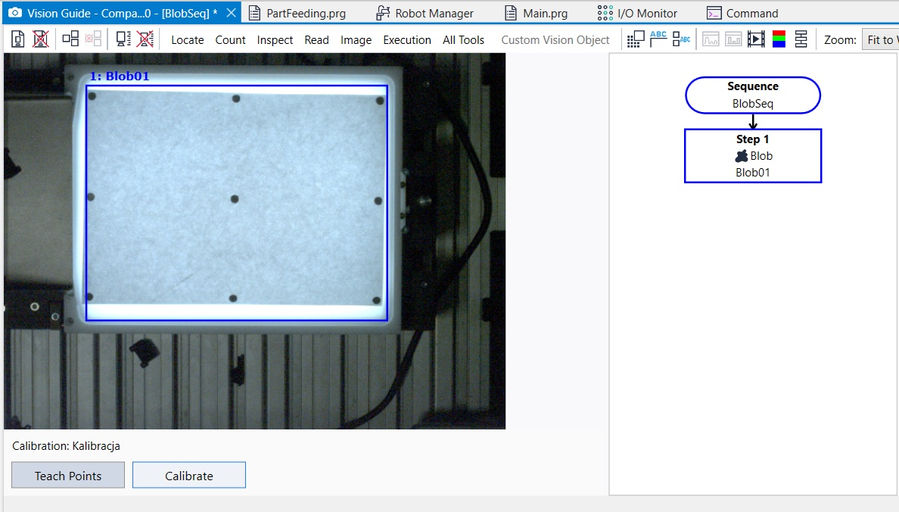

We właściwościach obiektu ustawiamy **NumberToFind** na **All**. Wartość wyświetla się na czerwono, bo różni się od domyślnej: program ma znaleźć wszystkie dziewięć punktów. **MinArea** wynosi 25 pikseli, **MaxArea** 200000 pikseli, więc odfiltrowane zostają drobne szumy i przypadkowe duże plamy. **Graphics** ustawione na **All** rysuje na obrazie wszystko, co obiekt znalazł.

Po uruchomieniu sekwencji na liście wyników widać **Result 1 of 9**. Przykładowy punkt ma **Found** równe True, pole **Area** 585 pikseli, **Angle** −68,390°, **CameraX** 243,536 mm i **CameraY** 211,256 mm. Liczba 9 przy wyniku oznacza, że płytka jest znaleziona w całości i można przejść do kalibracji.

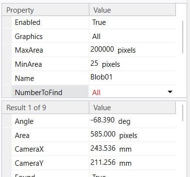

## Nowa kalibracja

W drzewie projektu, w gałęzi **Vision**, widać sekwencje **BlobSeq**, **Kalibracja**, **DuzyLens** i **MalyDetal** oraz gałąź **Calibrations** z kalibracją **Calibr**. W prawym górnym rogu RC+ połączenie jest ustawione na **USB**.

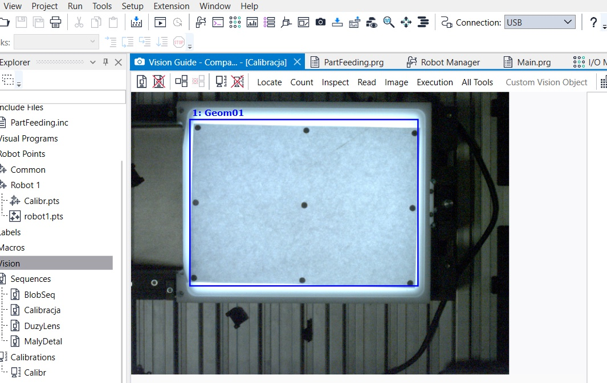

Nową kalibrację otwieramy przyciskiem na pasku okna **Vision**, zaznaczonym na zrzucie czerwoną ramką.

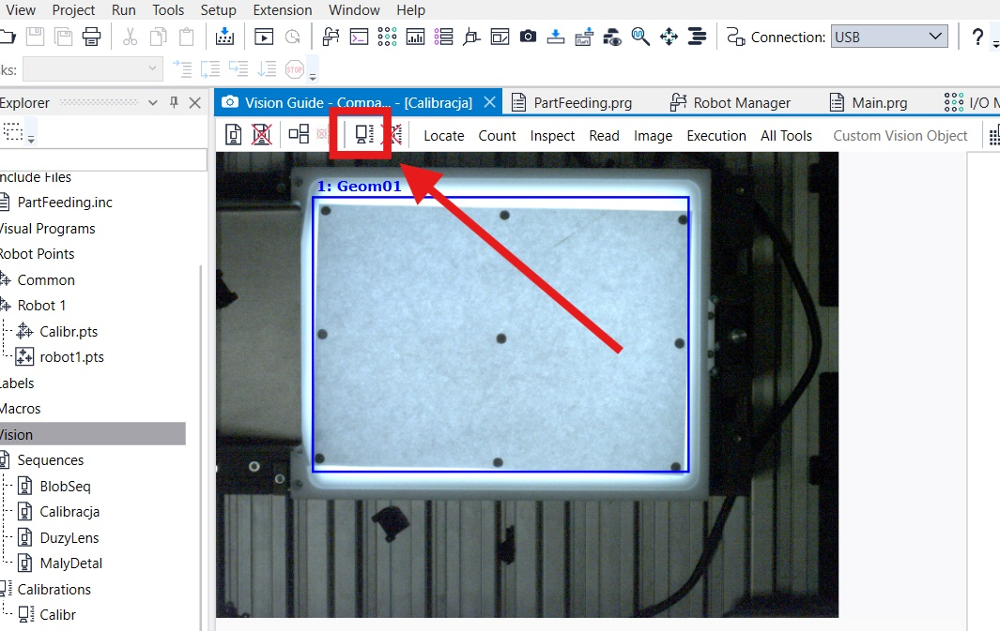

### Krok 1. Nazwa i kamera

Kreator ma 11 kroków. W kroku **General** wpisujemy nazwę **Kalibracja**, wybieramy **1. Camera 1** i zostawiamy puste pole kopiowania z istniejącej kalibracji. Klikamy **Next**.

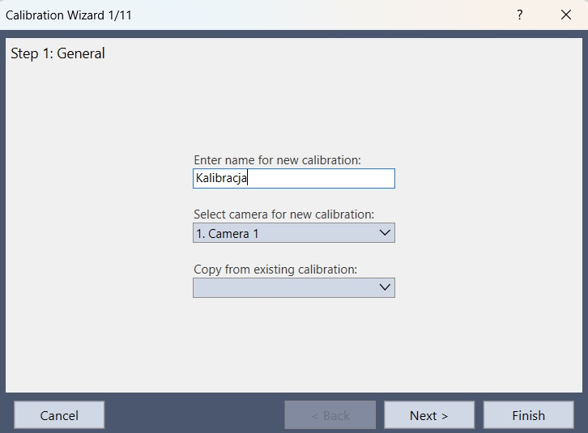

### Krok 2. Sposób pracy kamery

W kroku **Camera Usage & Orientation** decydujemy, jak kamera jest używana.

Do wyboru jest **Standalone Camera**, czyli kamera pracująca samodzielnie, oraz **Robot Camera**, czyli kalibracja przypisana do robota. Dla kamery robota wskazujemy robota na liście, tutaj **1, MNP01**, i sposób montażu:

- **Fixed looking upward** — kamera nieruchoma, patrząca w górę,
- **Fixed looking downward** — kamera nieruchoma, patrząca w dół,
- **Mounted on joint 2** — kamera zamocowana na drugim przegubie,
- **Mounted on joint 4** — kamera zamocowana na czwartym przegubie.

Na zrzucie zaznaczone jest **Robot Camera** oraz **Fixed looking downward**. Po prawej widać podgląd takiego układu: kamera na statywie nad robotem SCARA, oś Z skierowana w dół, a na stole układ osi X-Y.

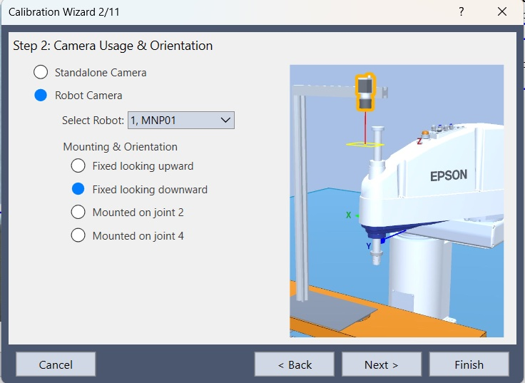

### Krok 3. Sekwencja wzorca

W kroku **Target Sequence** wskazujemy sekwencję, która podczas kalibracji znajduje punkty płytki. Wybieramy **BlobSeq**.

Nagłówek tego okna podaje orientację zapisaną w pokazanym przejściu kreatora: **Camera Orientation: Standalone**.

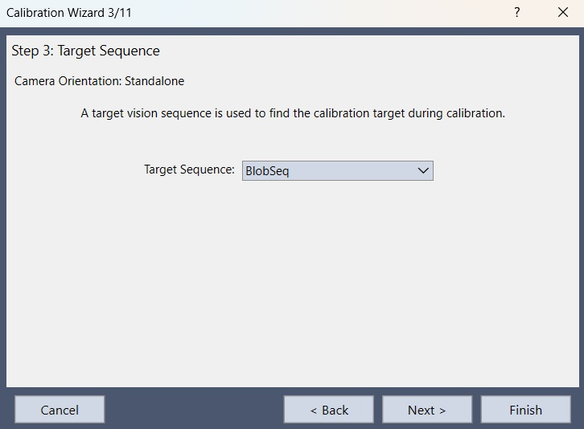

Kroki 4–7 oraz krok 10 przechodzimy przyciskiem **Next**. Poniżej są kroki, w których na stanowisku coś ustawiamy.

### Krok 8. Dystorsja obiektywu i pochylenie kamery

W kroku **Lens Distortion & Camera Tilt Compensation** włączamy opcję **Enable lens distortion and camera tilt compensation** i jako **Dist Correction Target Sequence** wskazujemy **BlobSeq**.

Korekcja korzysta z płytki leżącej w polu widzenia kamery. Dzięki niej skala obrazu pozostaje prawdziwa także przy brzegach kadru. Przy obiektywie o zauważalnej dystorsji albo przy kamerze, która nie stoi idealnie prostopadle do stołu, warto tę opcję zostawić włączoną.

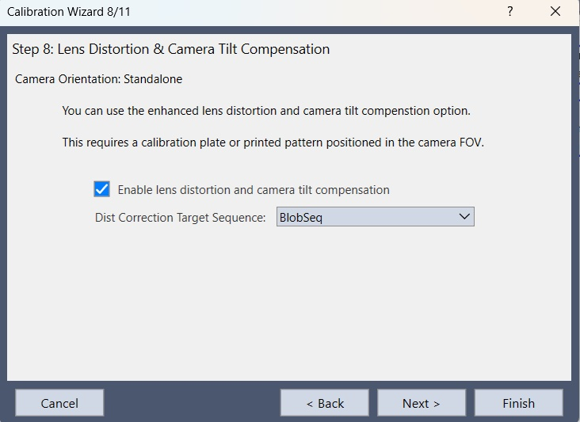

### Krok 9. Światło

W kroku **Light Control** pole **Calibration lamp on delay** zostawiamy na **0**, a **Calibration lamp output bit** na **None**.

Osobnej lampy kalibracyjnej nie używamy. Podświetlenie włącza sam podajnik, przypisany wcześniej do sekwencji **BlobSeq**. Wyjście lampy dla kamery patrzącej w górę jest wyszarzone, bo w tej konfiguracji go nie dotyczy.

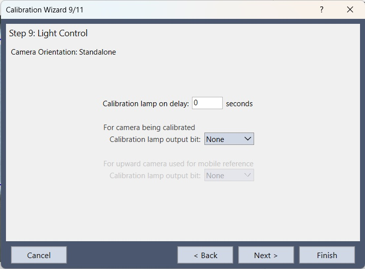

### Krok 11. Podsumowanie

Ostatni krok zbiera ustawienia:

- **Camera:** 1. Camera 1,
- **Camera Orientation:** Standalone,
- **Reference Type:** Taught Points,
- **Target Sequence:** BlobSeq.

**Taught Points** oznacza, że współrzędne punktów odniesienia zbierzemy sami, dojeżdżając do nich robotem. Klikamy **Finish**. Kalibracja **Kalibracja** zostaje zapisana w projekcie.

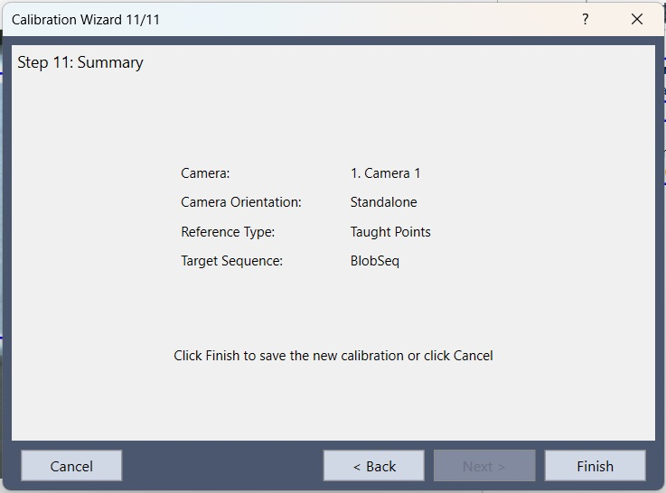

## Uczenie punktów

Po zamknięciu kreatora na dole okna **Vision** widać pasek **Calibration: Kalibracja**. Przycisk **Teach Points** jest aktywny. **Calibrate** jest jeszcze wyszarzony, bo żaden punkt nie został nauczony.

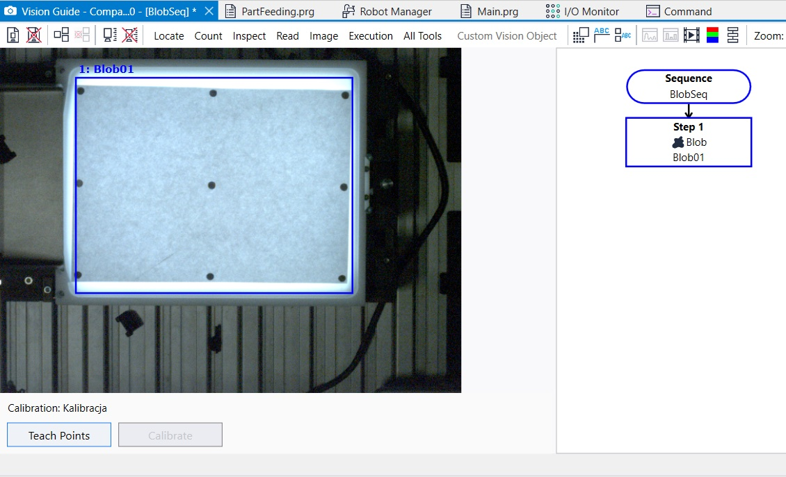

Klikamy **Teach Points**. Po lewej zostaje podgląd kamery z poleceniem, do którego punktu dojechać, po prawej lista kroków, a z boku panel **Jog**:

- **Motor: On**, **Power: Low** — silniki są włączone, a uczenie jedzie na małej mocy,
- robot **1, MNP01, T6-B602S**, narzędzie **Tool 0**, ramię **Arm 0**,
- układ **World**; osie **X**, **Y**, **Z** i **U** są aktywne, a **V** i **W** pozostają wyszarzone, bo T6 jest robotem SCARA,
- **Jog Distance** ma skok **Continuous**, **Long**, **Medium** i **Short**.

Do zgrubnego dojazdu wystarczy prędkość **High** i ruch ciągły. Ostatnie milimetry nad punktem ustawiamy skokiem **Short**, żeby końcówka trafiła w środek znacznika.

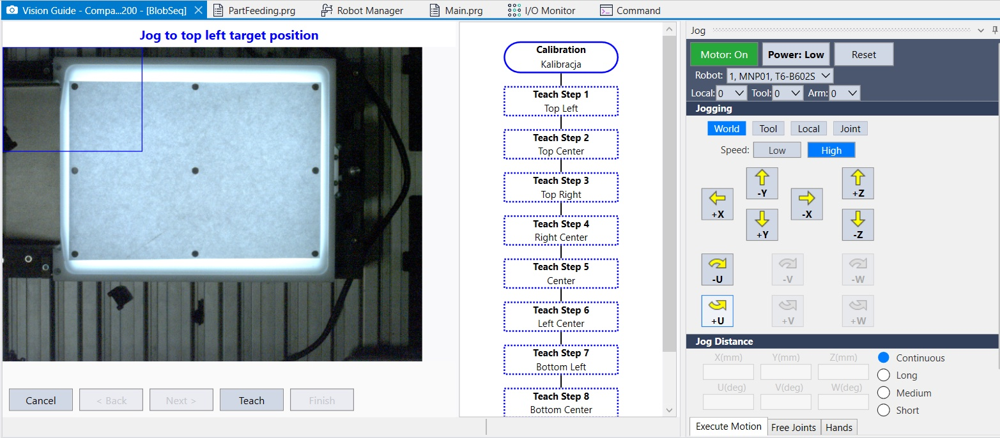

Kolejność punktów ustala program. Na liście po prawej widać:

1. **Top Left**,
2. **Top Center**,
3. **Top Right**,
4. **Right Center**,
5. **Center**,
6. **Left Center**,
7. **Bottom Left**,
8. **Bottom Center**,
9. **Bottom Right** — ostatnia pozycja jest poniżej widocznego fragmentu listy.

Dojeżdżamy końcówką roboczą do punktu, który wskazuje niebieski napis nad obrazem, i klikamy **Teach**. Ramię wchodzi wtedy w kadr kamery. Tak ma być: program uczy się pozycji robota w chwili, gdy końcówka stoi na znaczniku. Nauczony krok zmienia kolor na zielony.

Pierwszy punkt to lewy górny róg płytki.

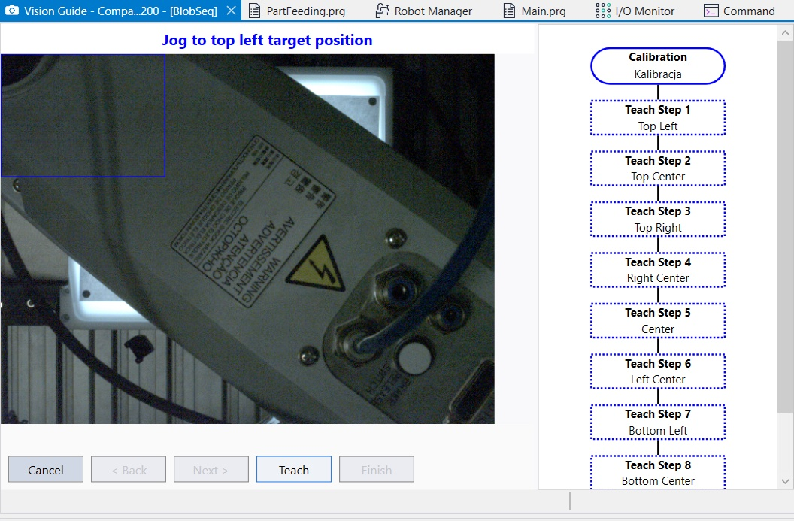

Po zatwierdzeniu pierwszego punktu program prosi o **Top Center**. **Teach Step 1** jest już zielony.

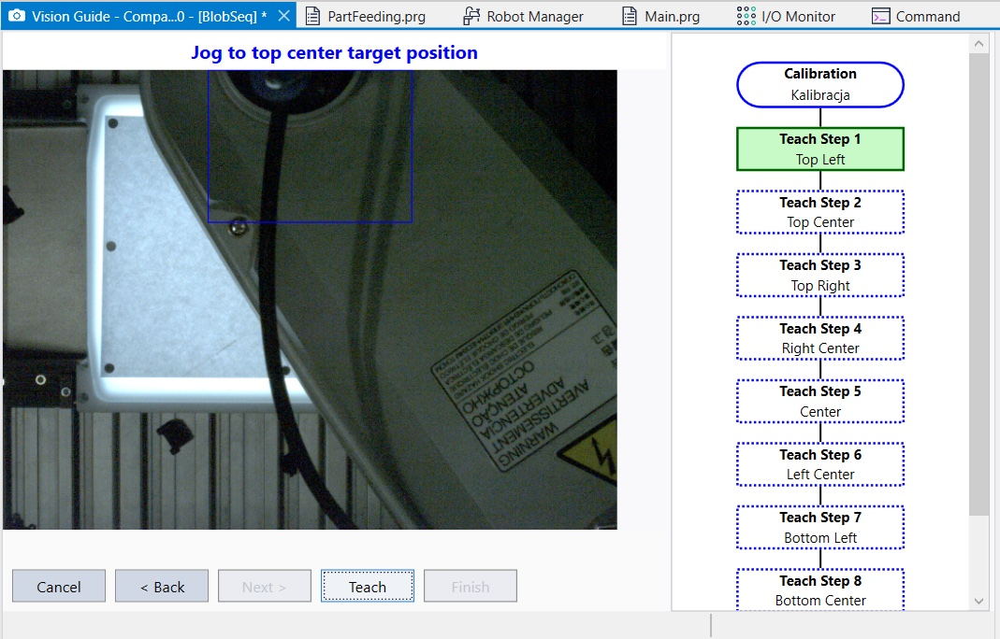

W połowie listy zielone są kroki od **Top Left** do **Right Center**, a program prosi o środek płytki, **Center**.

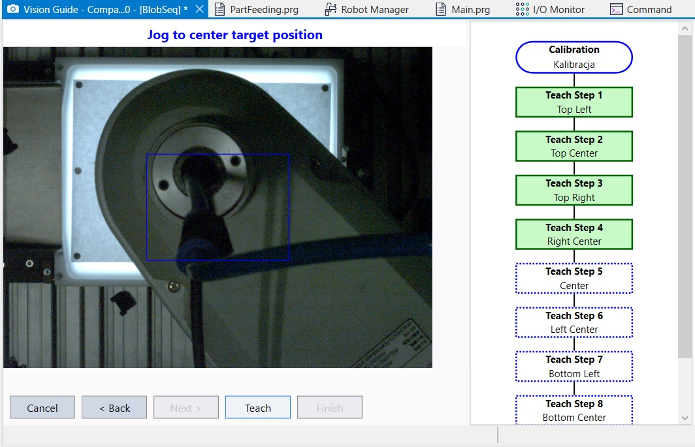

Gdy wszystkie kroki są zielone, nad obrazem pojawia się komunikat **All calibration points are now taught.** Aktywny staje się przycisk **Finish**. Klikamy go i wracamy do okna sekwencji.

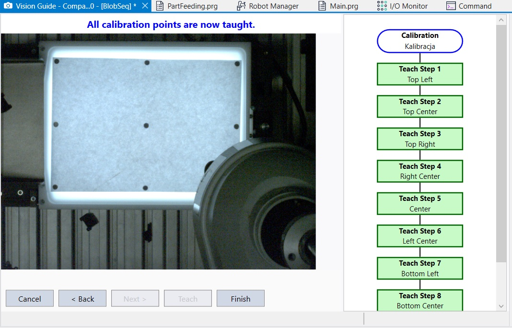

## Wynik kalibracji

Po nauce punktów przycisk **Calibrate** staje się aktywny, a **Teach Points** wygasza się. Klikamy **Calibrate**. Program uruchamia sekwencję **BlobSeq** (na obrazie widać napis **Calibration in cycle**) i po chwili pokazuje okno **Calibration Complete**.

Lewa kolumna, **Previous values**, jest pusta. To pierwsza kalibracja tej kamery, więc nie ma z czym porównywać. W kolumnie **New values** dostajemy:

| | X | Y |
|---|---|---|
| mm na piksel | 0,2049 | 0,2039 |
| błąd maksymalny | 0,3824 | 0,7339 |
| błąd średni | 0,0135 | 0,0085 |
| pochylenie | 1,09 | 2,03 |

Pole widzenia (**FOV**) wynosi **327,83 mm × 244,68 mm**.

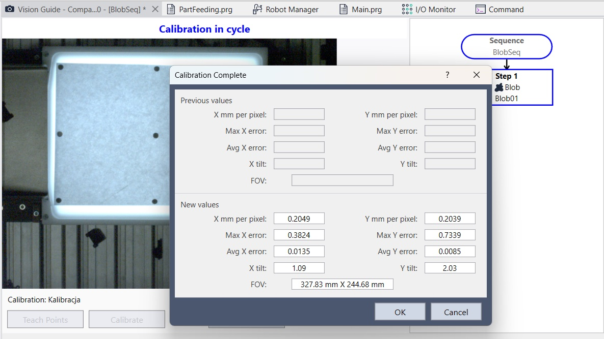

Skala w obu osiach jest prawie taka sama: jeden piksel to około 0,20 mm. Pochylenie kamery jest niewielkie, nieco ponad jeden stopień w osi X i dwa stopnie w osi Y.

Błąd średni to setne części milimetra, czyli wyraźnie mniej niż jeden piksel. Błąd maksymalny, 0,73 mm w osi Y, dotyczy najsłabszego z dziewięciu punktów. Przy kolejnym uruchomieniu **Calibrate** te liczby przejdą do kolumny **Previous values** i będzie widać, czy ponowne nauczenie punktu coś poprawiło.

Wynik zatwierdzamy przyciskiem **OK**.

Kalibrację powtarzamy, gdy ktoś poruszy kamerę, zmieni ostrość albo przysłonę, albo gdy detale zaczną leżeć na innej wysokości niż płytka, na której uczyliśmy punkty.

---

**Autor artykułu:**

**Maciej Tkacz**

Inżynier Robotyk, ASTOR
